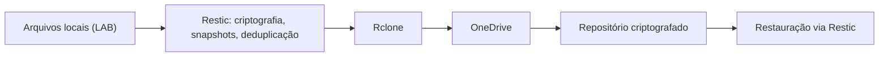

# Cloud Encrypted Backup — Restic + Rclone + OneDrive

 

Projeto prático de **backup criptografado e incremental em nuvem**, realizado em Windows 11 com **Restic**, **Rclone** e **Microsoft OneDrive**. Esta primeira versão documenta a configuração manual, a criação de snapshots, a restauração e os testes de integridade dos dados.

> **Escopo da v1.0:** backup e restauração executados manualmente. **Automação, agendamento, monitoramento e política de retenção ainda não fazem parte desta versão.**

## Objetivos

- Armazenar backups cifrados no OneDrive, mantendo os dados protegidos antes do envio.
- Demonstrar snapshots e backups incrementais com deduplicação.
- Restaurar dados em um diretório separado da origem.
- Verificar a integridade do repositório e comparar hashes SHA-256 de arquivos.
- Documentar o procedimento com evidências reproduzíveis de laboratório.

## Tecnologias

| Componente | Utilização |
| --- | --- |
| Windows 11 / PowerShell | Ambiente e execução de comandos |
| Restic 0.19.1 | Backup, criptografia, snapshots e restauração |
| Rclone 1.76.0 | Integração com OneDrive |
| Microsoft OneDrive | Armazenamento do repositório |

Versões conforme capturas do ambiente de teste; não representam requisitos mínimos.

## Arquitetura



**Laboratório documentado:** origem `C:\Backup-Restic\Dados`; repositório `rclone:onedrive-lab:Backup-Lab-Restic`; restauração `C:\Backup-Restic\Restauracao`. Esses caminhos são ilustrativos e devem ser adaptados ao ambiente.

## Documentação da v1.0

1. [Instalação e versões](docs/instalacao.md)
2. [Configuração do ambiente e backup](docs/configuracao.md)
3. [Restauração e conferência](docs/restauracao.md)
4. [Segurança e verificações de integridade](docs/seguraca.md)
5. [Índice das 16 evidências](docs/evidencias.md)

### Comandos essenciais (laboratório)

Após configurar o remoto do Rclone e a senha do repositório de forma segura:

```powershell
$env:RESTIC_REPOSITORY = "rclone:onedrive-lab:Backup-Lab-Restic"
restic backup "C:\Backup-Restic\Dados"
restic snapshots
restic stats
restic check
restic restore latest --target "C:\Backup-Restic\Restauracao"
```

A senha do Restic é indispensável para os comandos; **não** a inclua em scripts versionados, capturas ou histórico do terminal. Consulte [segurança](docs/seguraca.md).

## Resultados registrados

As evidências do laboratório cobrem: identificação das ferramentas, conexão com OneDrive, estrutura criptografada, backup inicial, múltiplos snapshots, comparação incremental, estatísticas, restauração, `restic check`, `restic check --read-data` e verificação SHA-256. A comparação de hashes documenta a igualdade dos arquivos selecionados para teste, **não** uma auditoria exaustiva de todos os arquivos.

## Evolução planejada

- **v1.0 — Backup criptografado e restauração:** escopo descrito neste documento.
- **Versão futura — Automação:** script PowerShell funcional, agendamento, logs, tratamento de erros e política de retenção; implementação e testes serão documentados separadamente.

## Observações de segurança

Este repositório **não** deve conter dados de clientes, arquivos originais de backup, tokens OAuth, `rclone.conf`, senhas, chaves ou identificadores sensíveis. O laboratório utiliza caminhos de exemplo; evite compartilhar capturas não revisadas.

**Licença:** não definida neste momento.
