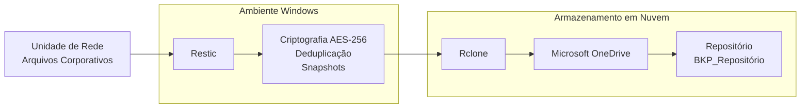

# Backup Criptografado com Restic, Rclone e OneDrive

Projeto de implementação de uma solução de backup
criptografado e incremental utilizando ferramentas
open source.

## Objetivo

Implementar uma rotina automatizada de backup de
arquivos armazenados em uma unidade de rede,
utilizando armazenamento em nuvem.

## Tecnologias utilizadas

- Windows 11
- PowerShell
- Restic
- Rclone
- Microsoft OneDrive
- Agendador de Tarefas do Windows

## Arquitetura da Solução

## Funcionalidades

- Backup criptografado
- Backup incremental
- Deduplicação de dados
- Automação de rotinas
- Política de retenção
- Restauração de arquivos
- Armazenamento em nuvem

## Documentação

- Instalação
- Configuração
- Automação
- Segurança
- Restauração

## Segurança

Este repositório utiliza configurações fictícias.

Nenhuma senha, token de acesso, identificação de
cliente ou configuração sensível é disponibilizada.

## Status

Em desenvolvimento.
