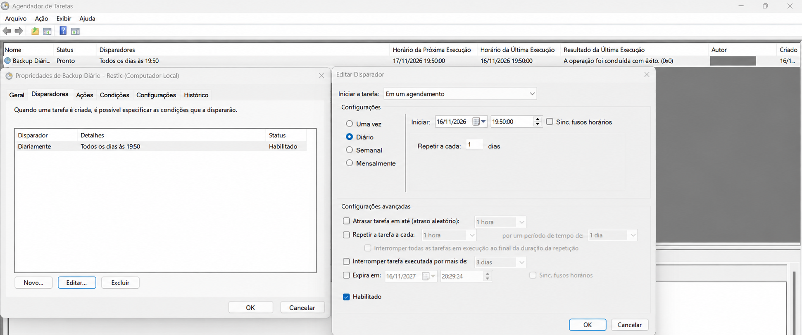
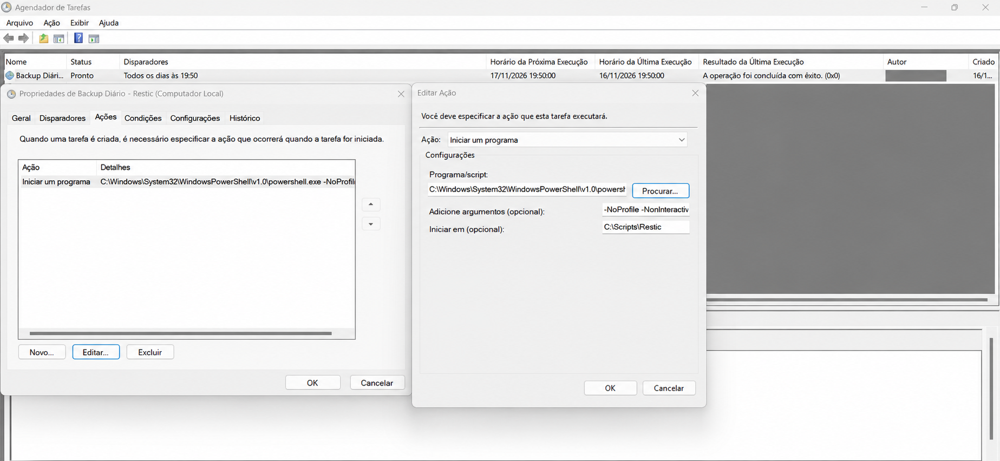
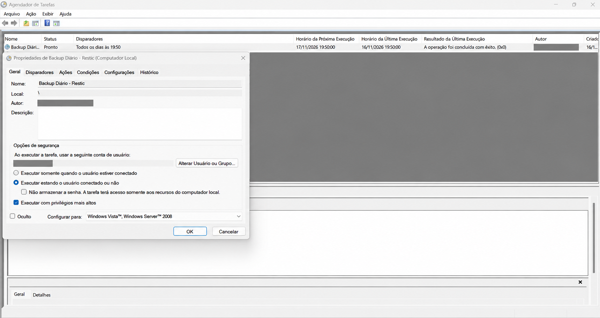
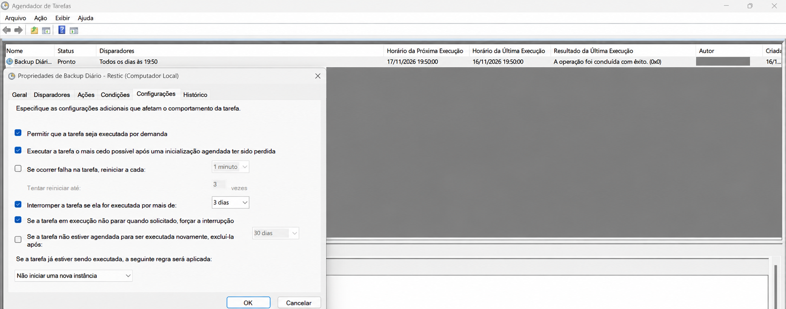
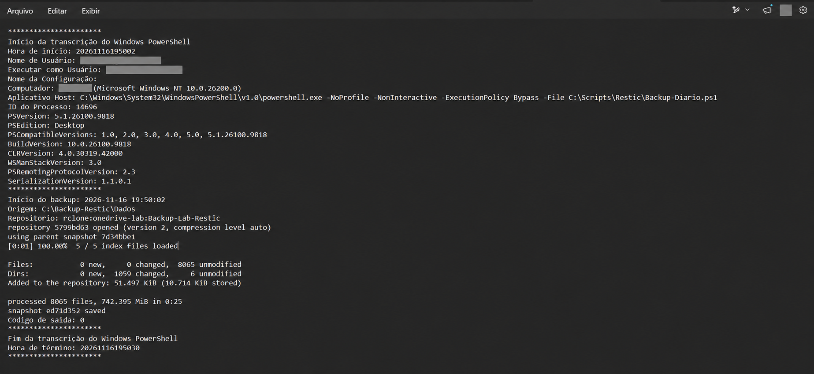

# Automação do backup no Windows 11 — v1.1

Rotina PowerShell com Restic, Rclone e Agendador de Tarefas. Os caminhos abaixo pertencem ao ambiente de validação, utilizado para documentar a solução em produção sem divulgar dados reais.

## Scripts publicados

- [Backup-Diario.ps1](../scripts/Backup-Diario.ps1): valida a origem e os arquivos necessários, inicia transcrição, executa o Restic e devolve seu código de saída.
- [Executar-Backup.ps1](../scripts/Executar-Backup.ps1): executor opcional de diagnóstico, com captura adicional da saída do processo.
- [backup.ps1](../scripts/backup.ps1): exemplo manual da v1.0, preservado para referência.

Os dois primeiros scripts foram fornecidos pelo responsável e revisados estaticamente. Não contêm senhas ou tokens. Foram adicionados comentários explicativos; o executor opcional passou a usar o prefixo de log `execucao_`, diferenciando-o da transcrição `backup_`. Não houve nova execução dos scripts publicados neste ambiente.

## 1. Preparar a máquina e a conta da tarefa

1. Concluir [instalação](instalacao.md), [configuração do Rclone](rclone-onedrive.md) e inicialização do repositório conforme [Restic](restic.md).
2. Copiar os dois scripts para `C:\Scripts\Restic`.
3. Revisar no início de `Backup-Diario.ps1`:
   - Origem: `C:\Backup-Restic\Dados`.
   - Repositório: `rclone:onedrive-lab:Backup-Lab-Restic`.
   - Executável: `C:\Tools\Restic\restic.exe`.
   - Senha: `Config\restic-password.txt`, relativo à pasta do script.
   - Configuração Rclone: `%APPDATA%\rclone\rclone.conf` da conta que executa a tarefa.
4. Criar o arquivo de senha local com a senha do repositório existente, fora da cópia do Git. Restringir suas permissões à conta da rotina e aos administradores autorizados. Não publicar seu conteúdo.
5. Confirmar que essa conta tem acesso à origem, à senha, ao Rclone e permissão de escrita na pasta de logs. `rclone.exe` precisa ser localizado pelo PATH da conta.
6. Não executar `restic init` novamente para um repositório existente.

O script verifica a existência dos arquivos, mas não verifica suas permissões de segurança. Consulte [Segurança](seguraca.md).

## 2. Agendamento e ação

Disparador diário às **19:50**, habilitado:



Na ação **Iniciar um programa**, preencher os campos separadamente.

**Programa/script:**

```text
C:\Windows\System32\WindowsPowerShell\v1.0\powershell.exe
```

**Adicionar argumentos:**

```text
-NoProfile -NonInteractive -ExecutionPolicy Bypass -File "C:\Scripts\Restic\Backup-Diario.ps1"
```

**Iniciar em:**

```text
C:\Scripts\Restic
```



Os argumentos completos foram informados pelo responsável; o campo aparece truncado na captura. A tarefa chama o script principal diretamente, sem necessidade do executor opcional.

## 3. Geral e Configurações



- Executar estando o usuário conectado ou não: selecionado.
- Executar com privilégios mais altos: selecionado.
- Não armazenar a senha: desmarcado.
- Compatibilidade exibida: Windows Vista / Windows Server 2008. Esse campo foi preservado como observado; o ambiente foi identificado pelo responsável como Windows 11.



| Opção | Estado observado |
| --- | --- |
| Permitir execução por demanda | Habilitado |
| Executar após agendamento perdido | Habilitado |
| Reiniciar em caso de falha | Desabilitado |
| Interromper execução prolongada | Após 3 dias |
| Forçar interrupção quando solicitado | Habilitado |
| Excluir tarefa sem novo agendamento | Desabilitado |
| Regra para tarefa já em execução | Não iniciar uma nova instância |

Essas são configurações observadas, não comprovação de testes de todos os cenários. O bloqueio de novas instâncias vale para essa tarefa; os scripts não implementam mutex para outras formas de execução.

## 4. Logs e resultado registrado

A transcrição é salva em `C:\Scripts\Restic\Logs\backup_AAAA-MM-DD_HH-mm-ss-fff.log`. O executor opcional cria também `execucao_AAAA-MM-DD_HH-mm-ss-fff.log`.



| Registro | Valor |
| --- | --- |
| Início | 16/11/2026 às 19:50:02 |
| Snapshot | `ed71d352` |
| Arquivos processados | 8.065 |
| Volume processado | 742,395 MiB |
| Tempo informado pelo Restic | 25 segundos |
| Arquivos novos / alterados | 0 / 0 |
| Código de saída | 0 |
| Fim da transcrição | 19:50:30 |

O log registra 51,497 KiB adicionados (10,714 KiB armazenados), com alterações em diretórios. Um novo snapshot pode existir sem mudança no conteúdo dos arquivos.

O Agendador mostra **Pronto**, última execução em 16/11/2026 às 19:50, resultado **0x0** e próxima execução em 17/11/2026 às 19:50. Os horários são compatíveis com o log, mas o histórico de eventos do disparo não foi apresentado. O fuso da máquina não foi verificado.

## 5. Tratamento de falhas e limites

- Origem ou arquivo obrigatório ausente gera falha; o código inicial de falha é 1.
- Após o backup, o script captura `$LASTEXITCODE` e o devolve com `exit`.
- Não há tratamento que transforme backup parcial ou arquivos inacessíveis em sucesso. Conferir o código e as mensagens, não apenas a existência de snapshot.
- Falhas na criação da pasta de logs ou no início da transcrição podem ocorrer antes do bloco de tratamento. Nesses casos, investigar também o resultado do processo e o histórico do Agendador.
- O executor opcional captura saída adicional, mas depende igualmente de acesso à pasta de logs.
- Não há alertas, retenção automática de snapshots, rotação de logs ou mutex nos scripts publicados.
- As ACLs da senha, as permissões da origem e os testes sem sessão aberta dependem de validação local.

## 6. Restauração já documentada

O [tutorial de restauração e validação](restauracao.md) cobre restauração em pasta separada, integridade e comparação em lote de **8.065 arquivos idênticos** no conjunto testado.

Não é necessário repetir a restauração para concluir esta versão da documentação. O teste anterior demonstra o procedimento de recuperação; não se afirma que o snapshot `ed71d352` foi restaurado. Testes periódicos de recuperação podem fazer parte da manutenção operacional futura.

## 7. Próximas melhorias

- Histórico de um disparo por horário, como evidência adicional opcional.
- Alertas para falha ou ausência de backup recente.
- Política de retenção validada antes de qualquer exclusão.
- Rotação de logs e testes de cenários de falha.

As cinco capturas foram editadas por IA para ocultar identificadores pessoais e outras tarefas. Os estados e números descritos foram conferidos nas capturas originais; a edição não representa uma nova execução.
