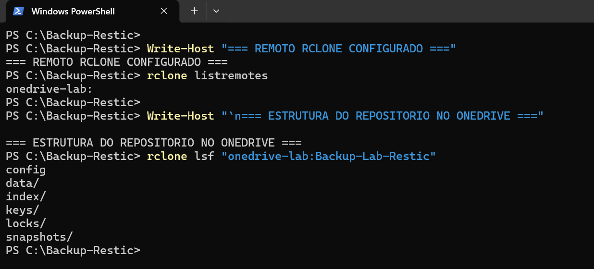
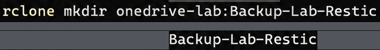
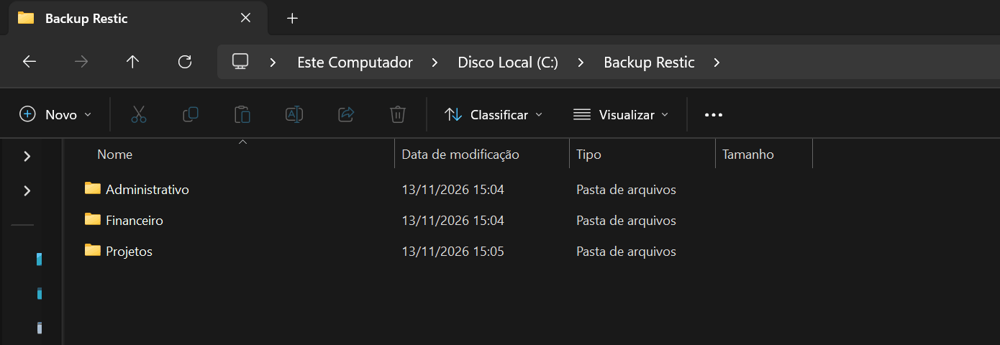
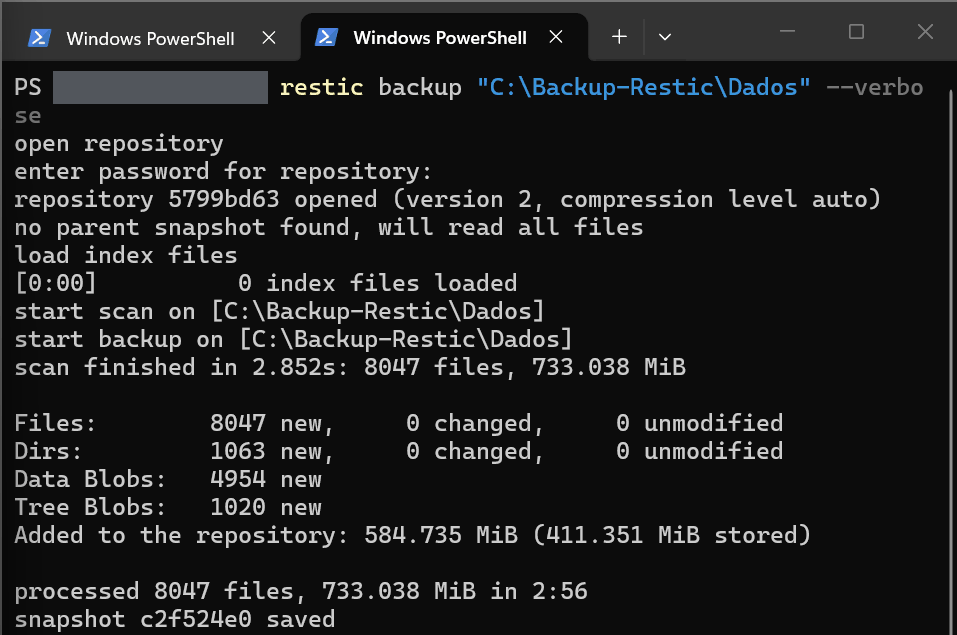
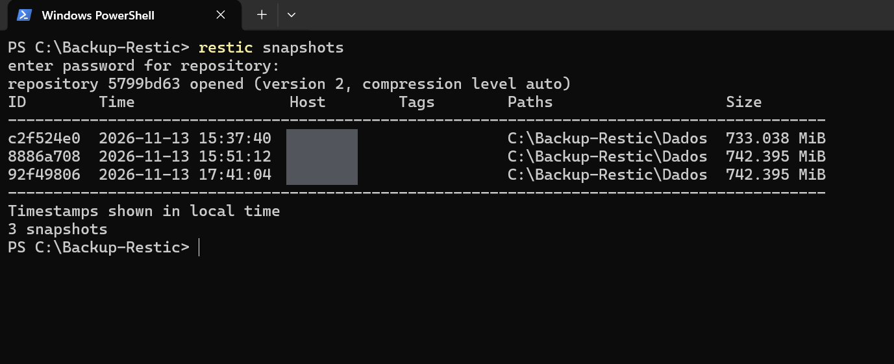
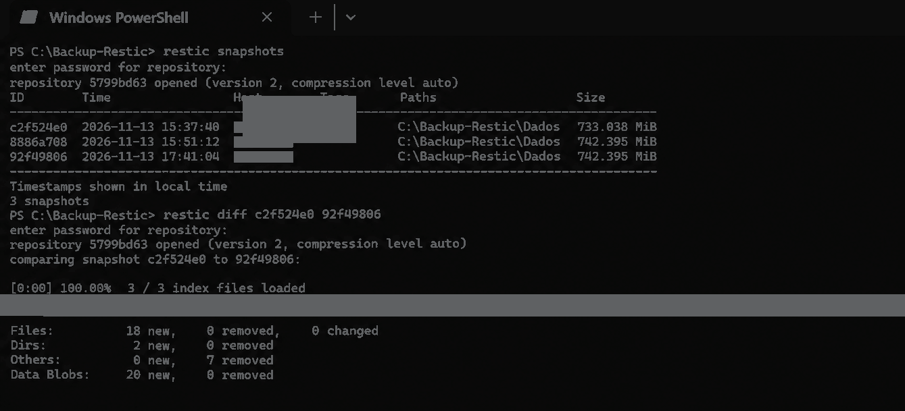
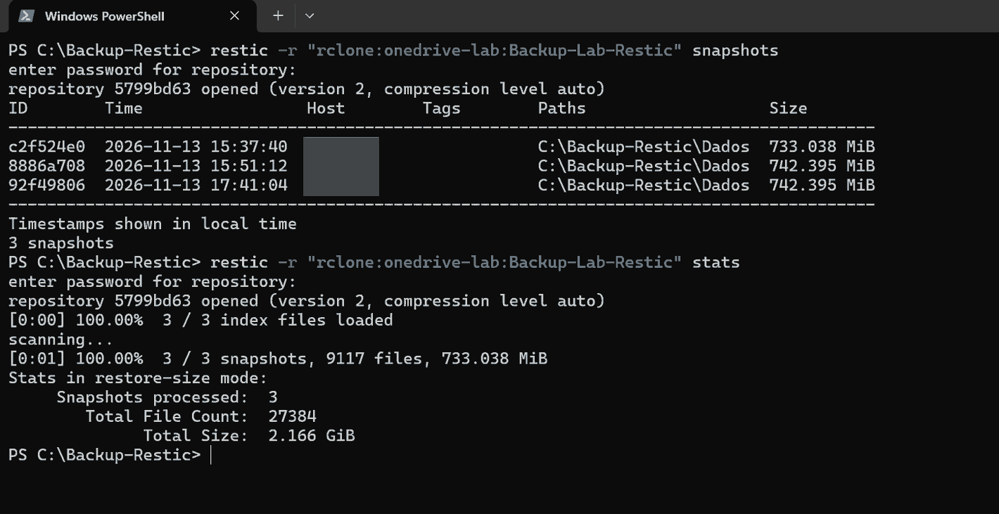

# Configuração e backup manual — v1.0

## Ambiente do laboratório

- Origem de teste: `C:\Backup-Restic\Dados`.
- Repositório remoto: `rclone:onedrive-lab:Backup-Lab-Restic`.
- Destino de restauração: `C:\Backup-Restic\Restauracao`.

A identificação `onedrive-lab` é o nome local do remoto Rclone e precisa existir na máquina de quem executar os comandos.

## 1. Configurar o Rclone

```powershell
rclone config
rclone listremotes
rclone lsf "onedrive-lab:"
```

Siga o [guia passo a passo de configuração do Rclone com OneDrive](rclone-onedrive.md) para criar o remote, autenticar a conta via OAuth, selecionar a unidade e validar o acesso. **Não publique** tokens, dados da conta nem o arquivo `rclone.conf`. Verifique em seguida a criação/visibilidade do diretório de destino.





## 2. Preparar os diretórios locais

```powershell
New-Item -ItemType Directory -Force "C:\Backup-Restic\Dados" | Out-Null
New-Item -ItemType Directory -Force "C:\Backup-Restic\Restauracao" | Out-Null
```

Inclua arquivos de teste sem dados pessoais na pasta `Dados`.



## 3. Definir o repositório e a senha

```powershell
$env:RESTIC_REPOSITORY = "rclone:onedrive-lab:Backup-Lab-Restic"
```

Antes de executar o Restic, informe sua senha interativamente ou utilize um **arquivo de senha local fora do Git e protegido por ACL**, referenciado por `RESTIC_PASSWORD_FILE`. Nunca registre a senha no README ou nos scripts.

**Inicialize o repositório somente se ainda não existir:**

```powershell
restic init
```

Se receber `config file already exists`, **não execute uma nova inicialização**: o repositório já foi criado. Valide com `restic snapshots`.

## 4. Executar o backup inicial

```powershell
restic backup "C:\Backup-Restic\Dados" --verbose
restic snapshots
```

O Restic gera um snapshot identificando o estado dos arquivos protegidos.





## 5. Validar a execução incremental

Modifique ou acrescente um arquivo de teste na origem e execute novamente:

```powershell
restic backup "C:\Backup-Restic\Dados"
restic snapshots
restic diff <ID_SNAPSHOT_ANTERIOR> <ID_SNAPSHOT_NOVO>
```

Substitua os identificadores pelos retornados por `restic snapshots`. O `diff` ajuda a identificar arquivos adicionados, alterados e removidos. Um novo snapshot **não** equivale necessariamente a transferir novamente todos os dados.



## 6. Consultar estatísticas

```powershell
restic stats
restic stats --mode raw-data
```

O tamanho lógico dos arquivos protegidos e o espaço efetivamente armazenado no repositório são métricas distintas. O espaço armazenado depende de versões retidas, deduplicação, compactação e metadados.

A captura mostra 2,166 GiB em modo `restore-size` para três snapshots. Esse valor é o tamanho lógico reportado pelo Restic. Na captura do backup inicial, 733,038 MiB foram processados e 411,351 MiB foram armazenados nessa execução.


