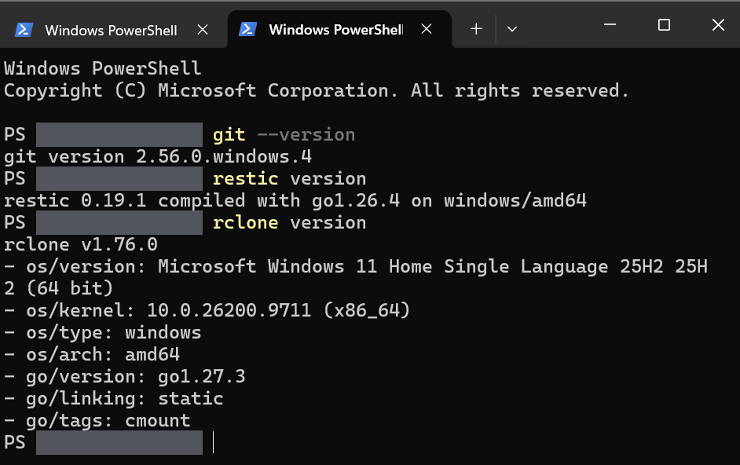

# Instalação

## Restic

No Windows, a instalação pode ser realizada
através do WinGet.

```powershell
winget install --id restic.restic -e
```

## Rclone

```powershell
winget install --id Rclone.Rclone -e
```

## Verificação

```powershell
restic version
rclone version
```


