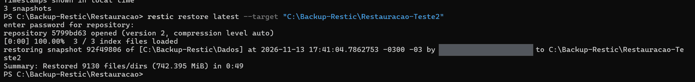
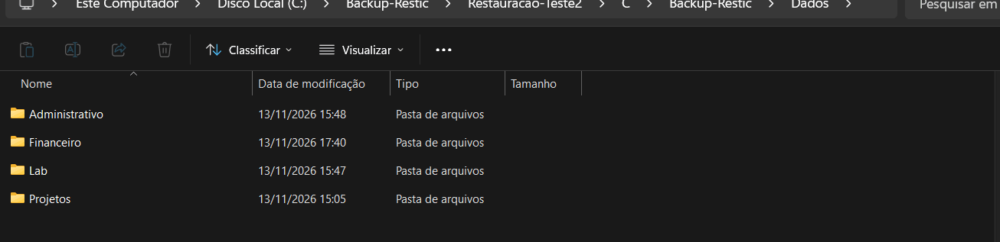
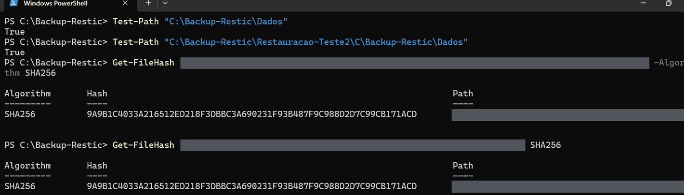
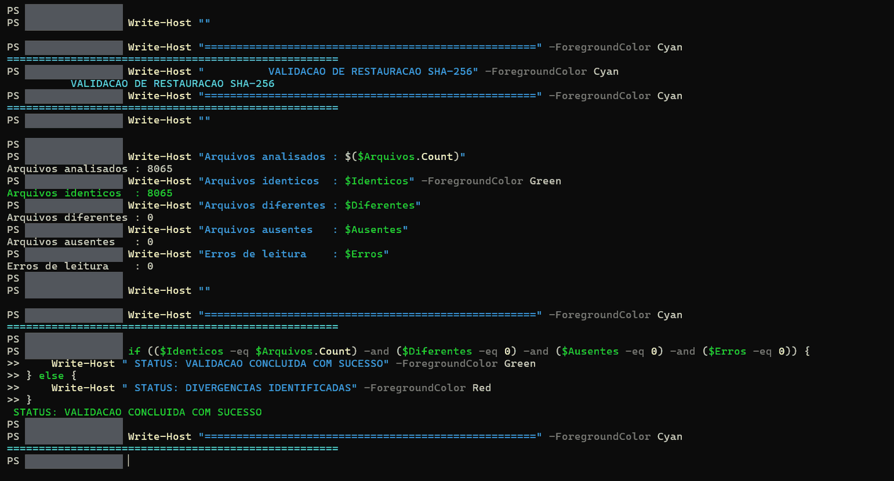

# Restauração e validação dos dados — v1.0

A restauração é realizada em **diretório separado**, evitando sobrescrever os arquivos de origem usados no teste.

## 1. Identificar um snapshot

```powershell
$env:RESTIC_REPOSITORY = "rclone:onedrive-lab:Backup-Lab-Restic"
restic snapshots
```

A senha correta do Restic deve estar disponível de forma segura, por entrada interativa ou arquivo de senha local protegido.

## 2. Restaurar o snapshot mais recente

```powershell
restic restore latest --target "C:\Backup-Restic\Restauracao"
```

Também é possível restaurar um snapshot específico:

```powershell
restic restore <ID_DO_SNAPSHOT> --target "C:\Backup-Restic\Restauracao"
```

O Restic normalmente recria a estrutura de caminho existente no snapshot dentro do diretório de destino. Portanto, valide o caminho efetivo dos arquivos restaurados, em vez de presumir que aparecerão diretamente na raiz de `Restauracao`.





## 3. Conferir os arquivos

- Confira a estrutura de pastas e a disponibilidade dos arquivos restaurados.
- Selecione um arquivo da origem e o arquivo correspondente restaurado.
- Calcule o SHA-256 **dos dois arquivos**, usando seus caminhos reais:

```powershell
Get-FileHash -Algorithm SHA256 -Path "C:\Backup-Restic\Dados\exemplo.txt"
Get-FileHash -Algorithm SHA256 -Path "C:\Backup-Restic\Restauracao\CAMINHO_RECRIADO\exemplo.txt"
```

Hashes iguais para o mesmo algoritmo indicam igualdade do conteúdo dos **arquivos comparados**. Isso não demonstra por si só que todos os arquivos foram restaurados.



A validação em lote reportou 8.065 arquivos analisados e idênticos, com zero diferenças, ausências ou erros de leitura.



## 4. Testar integridade do repositório

```powershell
restic check
restic check --read-data
```

`check` verifica a estrutura e os metadados do repositório; `--read-data` também lê e verifica os dados dos packs, aumentando o tempo e as operações de leitura. Faça esse teste em condições adequadas ao volume do repositório.

Veja as [capturas das verificações de integridade](seguraca.md#verificações-de-integridade).
