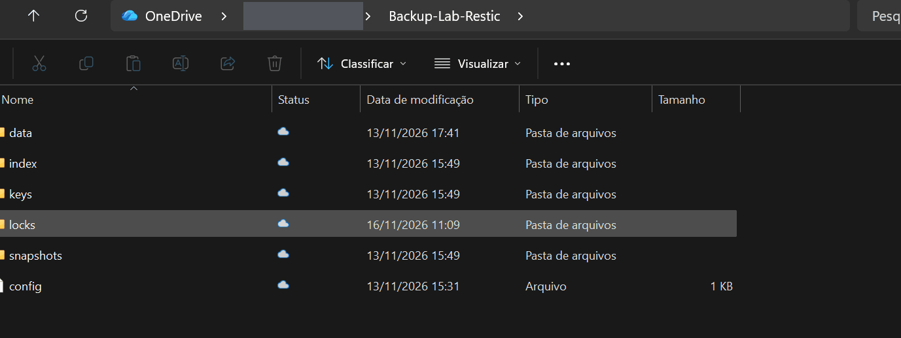
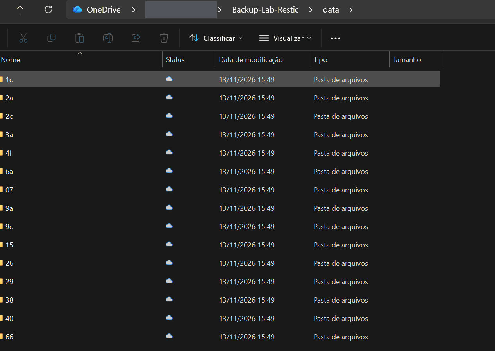
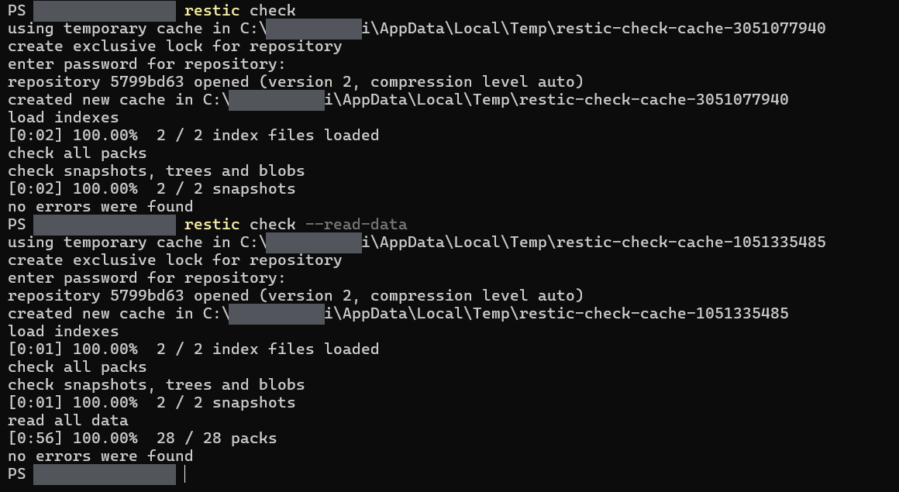
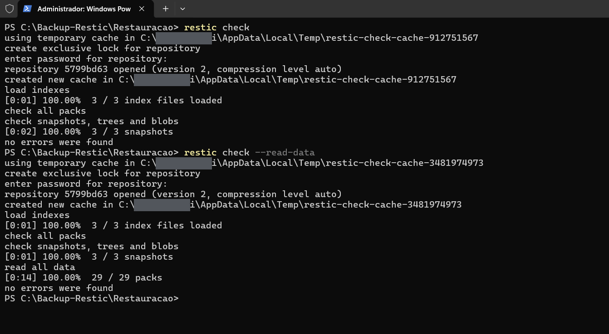

# Segurança

## Proteção do conteúdo

O **Restic criptografa os dados antes do armazenamento remoto** e permite restaurá-los com a senha correta do repositório. A estrutura de pastas do repositório (`data/`, `index/`, `keys/`, `snapshots/`) não apresenta os documentos originais legíveis no OneDrive.

A criptografia dos arquivos não elimina a necessidade de proteger o acesso à conta de nuvem nem a máquina utilizada para backups.

## Credenciais e senhas

- A senha do repositório Restic **não deve ser publicada**; sem ela, a recuperação pode tornar-se inviável.
- O arquivo `rclone.conf` pode conter dados de autenticação e tokens OAuth. **Nunca versioná-lo**.
- Utilize arquivo de senha fora da pasta do Git, com permissões restritas ao usuário da rotina, ou informe a senha interativamente.
- Não grave senhas em comandos, logs ou scripts publicados; evite `RESTIC_PASSWORD` em exemplos prontos para copiar por expor a senha no processo.
- Proteja a conta Microsoft com MFA e controle de acesso compatível com o ambiente.
- Preserve uma cópia segura da senha e documente um procedimento de recuperação, sem incluí-la no GitHub.

## Verificações de integridade

O `restic check` verifica a estrutura e os metadados do repositório.

O `restic check --read-data` também lê e verifica os dados dos packs.

A [conferência SHA-256 dos arquivos restaurados](restauracao.md#3-conferir-os-arquivos) está documentada junto à restauração.

## Atenção ao publicar capturas

Revise as imagens para eliminar nomes de pessoas, usuários locais, arquivos reais, diretórios particulares, dados de clientes, identificadores de contas e eventuais tokens. **O conjunto de evidências não deve ser interpretado como autorização para publicar quaisquer dados contidos em telas.**

## Ainda fora do escopo

Alertas, rotação de logs, política de retenção e recuperação automatizada permanecem para versões futuras. O agendamento e os scripts estão descritos em [Automação](automacao.md).

## Revisão dos scripts publicados

- A senha é lida de `Config/restic-password.txt`; seu conteúdo não está nos scripts nem deve ser registrado nos logs.
- O Rclone usa `rclone.conf` do perfil da conta de execução. As permissões desses arquivos devem ser verificadas no Windows; o script verifica sua existência, mas não audita ACLs nem criptografa o arquivo de senha.
- Os logs de transcrição podem conter usuário, computador, caminhos e erros com nomes de arquivos. Revise-os antes de publicar.
- O bloqueio de novas instâncias está configurado no Agendador. Os scripts fornecidos não implementam mutex; execuções manuais concorrentes não são bloqueadas por essa configuração.
- O código do Restic é devolvido ao processo. Arquivos sem acesso não são automaticamente excluídos nem convertidos em sucesso.
- A revisão foi estática. Não foi feita nova execução dos scripts, teste sem sessão aberta ou simulação de falha.
